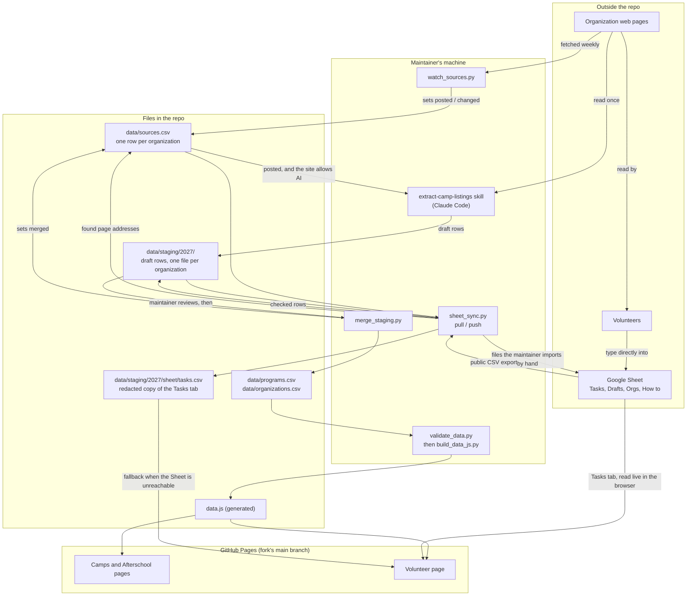
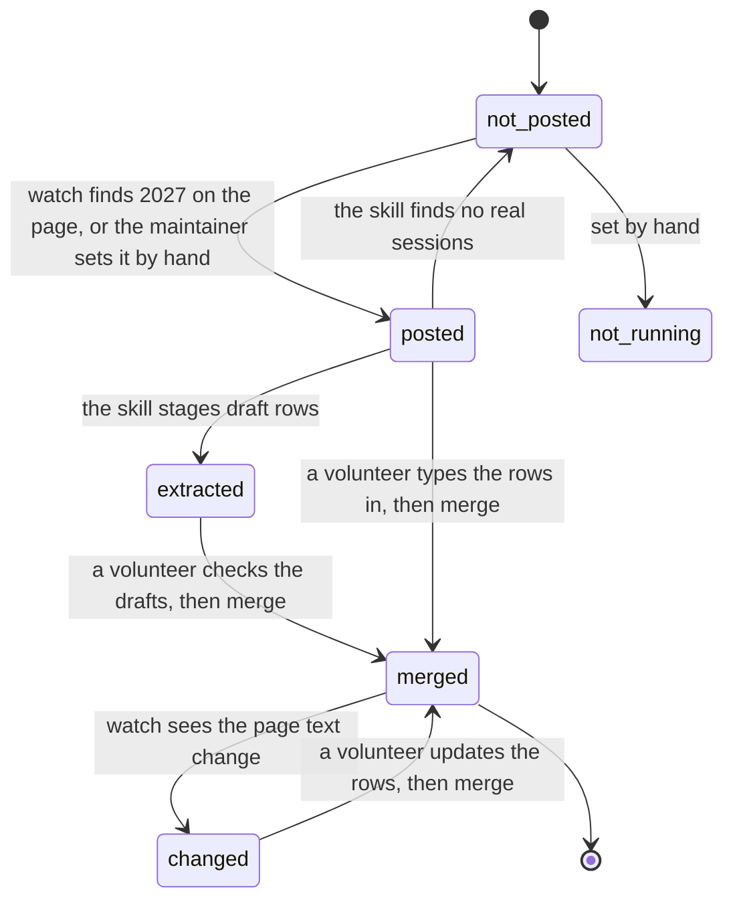
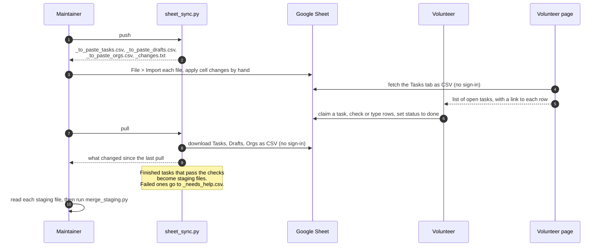
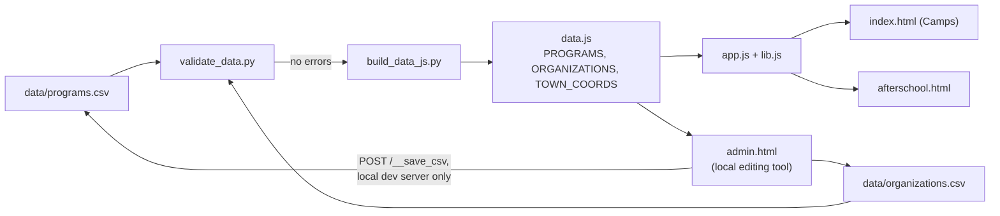

# How data flows through Camp Finder

Camp Finder is a static site. There is no server and no database: the data lives in CSV files in this repo, a script turns them into one JavaScript file, and GitHub Pages serves the result. The 2027 ingestion pipeline adds a way to get new-season camp listings into those CSV files, with a person checking every row first.

This page describes the flow as the code stands in November 2026. For the weekly commands, see [the runbook](../ingestion/runbook.md). For column definitions, see [the data architecture reference](../../camp-finder-data-architecture.md).

## 1. The whole system

Three things in this picture are easy to get wrong:

- **Nothing writes to the Sheet by program.** There is no Google API token anywhere in the repo or the site. Volunteers type into the Sheet themselves, signed in to their own Google accounts or as anonymous link visitors. `push` only writes files on the maintainer's machine, and the maintainer imports them into the Sheet by hand.
- **Everything reads the Sheet anonymously.** `pull` and the Volunteer page both use the Sheet's public CSV export, which works only while the Sheet is shared as "Anyone with the link: Viewer" or wider.
- **Only `merge_staging.py` writes 2027 rows into the live CSV files.** The skill, the volunteers and `pull` all stop at `data/staging/2027/`.

## 2. One organization, from "nothing posted" to "live"

Each organization's row in `data/sources.csv` carries a `status_2027`. The pipeline is the movement of that status.

Which path an organization takes after `posted` depends on two columns of its row:

| `kind` | `robots_ai_optout` | Who reads the page | Task a volunteer gets |
|---|---|---|---|
| `html` or `pdf` | `FALSE` | The skill drafts rows | `check_draft` (10 minutes) |
| `html` or `pdf` | `TRUE` or blank | A volunteer | `enter_new` (45 minutes) |
| `rec1`, `gated`, `manual` | any | A volunteer | `enter_new` (45 minutes) |

Two other tasks exist. `find_page` (2 minutes) is made when an organization has no page address or the watcher could not fetch it. `check_changes` (10 minutes) is made when a merged organization's page changes.

## 3. The Sheet round trip

The Sheet is the only place volunteers work. The scripts treat it as an untrusted inbox: they read it, check what they read, and never let it write to the live data directly.

What `pull` writes, and where it ends up:

| File | Contents | Committed? |
|---|---|---|
| `data/staging/2027/<org_id>.csv` | Rows from finished tasks that passed the checks | Yes |
| `data/sources.csv` | Page addresses from finished `find_page` tasks | Yes |
| `data/staging/2027/sheet/tasks.csv` | The Tasks tab with names, claim dates and notes blanked | Yes |
| `data/staging/2027/sheet/snapshot.json` | The date of the pull | Yes |
| `data/staging/2027/sheet/private/` | The three tabs exactly as downloaded, and `_needs_help.csv` | No, git-ignored |

Volunteer names are kept out of the repo by that redaction. They are still readable in the Sheet itself by anyone with the link.

## 4. From CSV to the page a family sees

- `build_data_js.py` runs the validator first and stops on any error. It joins each program with its organization's fields, drops inactive programs, and writes `data.js`.
- `data.js` is committed. GitHub Pages serves the repo's files as they are, so a change reaches the site when a commit containing the new `data.js` lands on the fork's `main` branch.
- The Camps and Afterschool pages load `data.js` with a script tag and do all filtering, mapping and calendar work in the browser. They make no data requests of their own.
- The Admin page can save only through `scripts/dev_server.py` on the maintainer's machine. On the published site its save has nowhere to go.

## 5. Where untrusted input enters

| Input | Who can supply it | What stands between it and the site |
|---|---|---|
| Organization page text | The organization, or whoever controls the page | The skill treats page text as data; a volunteer checks each draft row against the page; the maintainer reads each staging file before merge |
| Sheet cells | Anyone with edit access to the Sheet | `pull` rejects formula cells, bad dates, wrong ids and non-public addresses; the maintainer reads each staging file before merge |
| A page address from a `find_page` task | Anyone with edit access to the Sheet | `pull` refuses non-http addresses, bare IP addresses and local names. It cannot tell whether a site belongs to the organization, so the maintainer opens each new address before running the watcher |

The last row is the reason to restrict who can edit the Sheet: the watcher fetches every address in `data/sources.csv` from the maintainer's machine.

## Not built

These appear in the plans but do not exist in the code:

- Writing to the Sheet from a script (a service-account key).
- A reader for Rec1 registration sites; those four towns are checked and typed in by hand.
- An importer for a spreadsheet export from a recreation department.
- Any check of the Sheet's real sharing setting. `public_edit` in `data/ingest_config.json` is a note the maintainer keeps, not a measurement.
